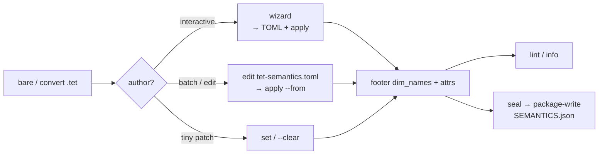

# Declared semantics + caller policy

Optional **declared** science and media facts live in the `.tet` footer (`dim_names`, string `attrs`, append-only `history`). **Interpretation** (unit convert, seconds↔index, geo crops) stays in caller policy outside the file. The crate is not a plugin host and has no climate- or video-special mode. Declared attrs do **not** change fold or query answers by themselves.

Open, verify, and query stay valid when none of these keys are present.

## Declare vs policy

| Layer | Where | What |
| ----- | ----- | ---- |
| **Declared** | Footer `dim_names` + `attrs` + `history` | Facts about this sealed file |
| **Interpreted** | `tet-semantics.toml` policy tables | What the app does with those facts |

One file can hold **both**. `tet semantics apply` / `wizard` stamp only declare facts into the footer; `[profiles.*]` formulas and `[units.*]` stay in the TOML. The crate does **not** load the TOML unless you pass `--from` (or the wizard writes + applies it).

Optional package **`SEMANTICS.json`** (beside `packed.tet` in `generations/<G>/`) mirrors declared attrs and `dim_names` for tools — ignore-unknown; fold-inert. Stamp a **mutable** `.tet`, seal a **new** generation, then `tet semantics package-write`. Do not rewrite sealed `packed.tet` in place.

Layout stays **`layout_version` 1** (optional `THST` history). Attrs are string maps; unknown keys are ignored; absence of every recommended key is valid. Provenance prefers `history` rows over parallel provenance attrs — see [`prov_log.v1`](https://github.com/Latka-Industries/tetration/blob/main/docs/semantics_profiles.md#prov_logv1).

## How to stamp (wizard · TOML · set)

All three paths write the **same** footer declare surface (`dim_names` + string attrs). Pick by how you want to author — they compose.

| Path | Best for | Writes TOML? | Stamps `.tet`? |
| ---- | -------- | ------------ | -------------- |
| **`wizard`** | First pass on a bare clip; guided dims + profile | Yes (default `tet-semantics.toml` beside the file) | Yes (unless `--no-apply`) |
| **`apply` / `scaffold` / `annotate`** | Repeatable / CI / editing policy by hand | You own the file (`--from` / `-o`) | `apply` yes; `scaffold` no |
| **`set` / `--clear`** | One-off attr tweaks without touching TOML | No | Yes |
| Convert / writer | Source already carried attrs | — | At write time |



### Typical flows

**1. Interactive first stamp (wizard owns the loop)**

```bash
tet semantics wizard clip.tet
# prompts: dataset (if many) → axis names → profile → recommended attrs → extras → confirm
# writes tet-semantics.toml beside clip.tet, then apply
tet info clip.tet --metadata
tet semantics lint clip.tet
```

On confirm, `n` redoes prompts with the last selection pre-filled (shown in `[brackets]`). **Enter** keeps last; **`-`** clears/skips a field. Dim names are required (cannot leave empty). `--dataset NAME` skips the picker; `-o FILE` sets the TOML path; `--no-apply` writes TOML only (handy before you are ready to stamp).

**2. Wizard drafts TOML → you edit policy → re-apply**

```bash
tet semantics wizard clip.tet --no-apply -o clip-semantics.toml
# edit [profiles.*] / [units.*] (and declare keys if needed)
tet semantics apply clip.tet --from clip-semantics.toml
```

Wizard and `apply` share stamp rules: declare only; formulas stay in the TOML; present fields overwrite; omitted fields stay untouched; `--from` is never rewritten.

**3. Batch / CI from a known TOML (no wizard)**

```bash
# start from a snippet or from what is already on the file
tet semantics scaffold clip.tet -o tet-semantics.toml
# or: cp docs/semantics_snippets/media.v1.toml tet-semantics.toml
tet semantics apply clip.tet --from tet-semantics.toml
tet semantics apply clip.tet --from tet-semantics.toml --annotate -o annotated.toml
```

`scaffold` / `apply --annotate` emit the combined file; missing recommended keys are `# key =` comments. With nothing declared, scaffold prints catalog lines plus doc links — **no invented config**.

**4. Patch one attr without a TOML round-trip**

```bash
tet semantics set clip.tet --dataset frames --set frame_rate=60
tet semantics set clip.tet --dataset frames --clear color_space
```

`set` does not update `tet-semantics.toml`. If you keep a TOML as source of truth, either re-`scaffold` / annotate after, or prefer `apply` for the next full stamp.

**5. Package**

Stamp a **mutable** `.tet`, seal a **new** generation, then:

```bash
tet semantics package-write package.tet.d
```

App-only policy (TOML never applied) is fine for one pipeline, weak for sharing. `tet info` (default table and `--json`) shows stamped `dim_names` and attrs — never policy formulas. Full flags: [`tet semantics`](/cli/semantics).

## Declared keys

Recommended attr names. Values are strings; TOML apply coerces number/bool → string (e.g. `frame_rate = 30` → `"30"`).

| Key | Meaning | Example |
| --- | ------- | ------- |
| `units` | Physical or dimensionless unit token | `"K"`, `"uV"`, `"1"` |
| `frame_rate` | Samples along `time_axis` per `frame_rate_unit` | `"30"` |
| `frame_rate_unit` | Unit for `frame_rate` | `"Hz"` |
| `sample_rate` | Continuous-signal rate | `"30000"` |
| `sample_rate_unit` | Unit for `sample_rate` | `"Hz"` |
| `time_axis` | Axis index that advances in time | `"0"` |
| `crs` | Coordinate reference id | `"EPSG:4326"` |
| `media_kind` | Soft label | `"video"`, `"timeseries"` |
| `color_space` | Soft label when pixels are color | `"sRGB"` |
| `pixel_unit` | Soft label for spatial axes | `"px"` |
| `start_time` | ISO-8601 or epoch string | `"2026-10-20T15:00:00Z"` |
| `semantics_profile` | Doc profile id (not a Rust enum) | `"media.v1"` |
| `uncertainty_kind` | How uncertainty is attached | `"1sigma"` |
| `uncertainty_sibling` | Catalog name of an error / σ dataset | `"tas_err"` |
| `standard_name` | Optional CF-style name | `"air_temperature"` |

Also stampable: **`dim_names`** (axis names in rank order). **`coords` via apply are not supported** — apply rejects them.

**Vocabulary (not enforced on decode):** units `K`, `degC`, `uV`, `mV`, `Hz`, `1`, `px`; CRS `EPSG:####` when an EPSG code exists. **Profile ids (canonical):** `media.v1`, `timeseries.v1`, `cf_lite.v1`, `prov_log.v1`. Aliases `media_v1` / `v1.media` (same pattern for the others; `climate_v1` → `cf_lite.v1`) still normalize. Open minting allowed (advisory lint only). Registry: crate [`semantics_profiles.md`](https://github.com/Latka-Industries/tetration/blob/main/docs/semantics_profiles.md).

## One-file `tet-semantics.toml`

Convention name only — pass the path with `--from`. Canonical snippet: [`media.v1.toml`](https://github.com/Latka-Industries/tetration/blob/main/docs/semantics_snippets/media.v1.toml).

```toml
schema_version = 1

[datasets.frames]
dim_names = ["t", "y", "x"]

[datasets.frames.attrs]
semantics_profile = "media.v1"
media_kind = "video"
frame_rate = 30
frame_rate_unit = "Hz"
time_axis = 0
pixel_unit = "px"

[profiles.media.v1]
index_to_seconds = "index / frame_rate"
seconds_to_index = "floor(seconds * frame_rate)"

[units.Hz]
display = "Hz"
```

**Stamped:** `dim_names`, attrs (including `semantics_profile`). **Left in TOML:** `[profiles.*]`, `[units.*]`. Present fields overwrite; omitted fields stay; `--from` is never rewritten. Validate: dataset exists; `dim_names.len() == rank`; `time_axis` in range when set. Map wall-clock or display units to indices in the app **before** building a query document.

## Relation to query

Cell `filter`, zone maps, and value postings are unchanged by declared semantics. Policy may map wall-clock or display units to indices / dtype before a query document is built — caller-side only.

## Not in scope

- Plugin / dynamic code load inside the crate
- Mandatory semantics on every file
- Full CF / PROV compliance suite
- Built-in climate or media modes / UCUM engine
- Conversion tables stored inside `packed.tet`
- Executing policy at fold / query time
- Footer-embedded formulas
- Coords via apply

## Worked examples

None of these enable a special runtime mode — facts and doc profile ids only.

### Video / recording

Tracked fixture: `fixtures/small/tet/recording.tet` in the crate repo (`frames` `[6,2,2]`, `dim_names = ["t","y","x"]`, `media.v1` attrs + `semantics` history row).

```bash
tet info fixtures/small/tet/recording.tet
tet semantics scaffold fixtures/small/tet/recording.tet -o tet-semantics.toml
# tet semantics apply clip.tet --from docs/semantics_snippets/media.v1.toml
```

### Timeseries / climate-as-attrs

```bash
tet semantics apply signal.tet --from tet-semantics.toml   # timeseries.v1 dims + sample_rate formulas
tet semantics set grid.tet --dataset tas \
  --set units=K --set standard_name=air_temperature \
  --set crs=EPSG:4326 --set semantics_profile=cf_lite.v1
```

Display Kelvin as °C belongs in caller policy, not inside `packed.tet`. Snippets: [`timeseries.v1.toml`](https://github.com/Latka-Industries/tetration/blob/main/docs/semantics_snippets/timeseries.v1.toml), [`cf_lite.v1.toml`](https://github.com/Latka-Industries/tetration/blob/main/docs/semantics_snippets/cf_lite.v1.toml).

## Related

- [`tet semantics` CLI](/cli/semantics)
- [Format versioning](/format/versioning) — history footer / layout v1
- [Query document](/query/document) — wire stays index-based
- Crate notes: [`docs/semantics.md`](https://github.com/Latka-Industries/tetration/blob/main/docs/semantics.md)
- Profile registry: [`docs/semantics_profiles.md`](https://github.com/Latka-Industries/tetration/blob/main/docs/semantics_profiles.md)
