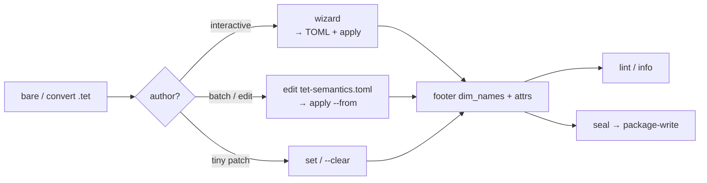

# Declared semantics + caller policy

Optional **declared** facts live in the `.tet` footer (`dim_names`, string `attrs`, append-only `history`). **Interpretation** (unit convert, seconds↔index, geo crops) stays in caller policy outside the file. Declared attrs do **not** change fold or query answers. Open / verify / query stay valid with none of these keys set. Not a plugin host and not a climate- or video-special mode.

## Declare vs policy

| Layer | Where | What |
| ----- | ----- | ---- |
| **Declared** | Footer `dim_names` + `attrs` + `history` | Facts about this sealed file |
| **Interpreted** | `tet-semantics.toml` policy tables | What the app does with those facts |

One TOML can hold **both**. `wizard` / `apply` stamp only declare facts; `[profiles.*]` and `[units.*]` stay in the file. The crate loads that TOML only via `--from` (or when the wizard writes + applies it).

Layout stays **`layout_version` 1** (optional `THST`). Attrs are string maps; unknown keys ignored; missing recommended keys are fine. Provenance prefers `history` rows — see [`prov_log.v1`](https://github.com/Latka-Industries/tetration/blob/main/docs/semantics_profiles.md#prov_logv1).

Package **`SEMANTICS.json`** (beside `packed.tet`) mirrors declare for tools — ignore-unknown, fold-inert. Stamp a **mutable** `.tet`, seal a **new** generation, then `package-write`. Never rewrite sealed `packed.tet` in place.

## How to stamp (wizard · TOML · set)

Same footer surface either way. Pick by how you author.

| Path | Best for | TOML | Stamps `.tet`? |
| ---- | -------- | ---- | -------------- |
| **`wizard`** | Guided first pass | Writes default `tet-semantics.toml` beside the file | Yes (unless `--no-apply`) |
| **`apply` / `scaffold` / `annotate`** | Batch / CI / hand-edit policy | You own `--from` / `-o` | `apply` yes; `scaffold` no |
| **`set` / `--clear`** | One-off attr patch | No | Yes |
| Convert / writer | Source already had attrs | — | At write time |

**Shared stamp rules:** declare only; present fields overwrite; omitted stay; `--from` is never rewritten.



### Flows

**1. Interactive first stamp**

```bash
tet semantics wizard clip.tet
tet info clip.tet --metadata
tet semantics lint clip.tet
```

Prompts: dataset (if many) → axis names → profile → recommended attrs → extras → confirm. Then writes TOML + apply. Confirm `n` redoes with last selection in `[brackets]`. **Enter** keeps last; **`-`** clears/skips. Dim names required. `--dataset`, `-o`, `--no-apply` as on [`tet semantics`](/cli/semantics).

**2. Draft TOML → edit policy → apply**

```bash
tet semantics wizard clip.tet --no-apply -o clip-semantics.toml
# edit [profiles.*] / [units.*]
tet semantics apply clip.tet --from clip-semantics.toml
```

**3. Batch / CI (no wizard)**

```bash
tet semantics scaffold clip.tet -o tet-semantics.toml
# or start from docs/semantics_snippets/media.v1.toml
tet semantics apply clip.tet --from tet-semantics.toml
tet semantics apply clip.tet --from tet-semantics.toml --annotate -o annotated.toml
```

`scaffold` / `--annotate`: missing recommended keys as `# key =` comments; nothing declared → catalog + doc links only (no invented config).

**4. One-off patch**

```bash
tet semantics set clip.tet --dataset frames --set frame_rate=60
tet semantics set clip.tet --dataset frames --clear color_space
```

Does not update TOML. If TOML is source of truth, re-`scaffold` / annotate later, or use `apply` for the next full stamp.

**5. Package** — after stamp + seal: `tet semantics package-write package.tet.d`.

App-only policy (never apply) is fine for one pipeline, weak for sharing. `tet info` shows declare under datasets — never policy formulas.

## Declared keys

Values are strings; TOML apply coerces number/bool → string (`frame_rate = 30` → `"30"`). Also stampable: **`dim_names`** (rank order). **`coords` via apply are rejected.**

| Key | Meaning | Example |
| --- | ------- | ------- |
| `units` | Physical or dimensionless unit token | `"K"`, `"uV"`, `"1"` |
| `frame_rate` | Samples along `time_axis` per `frame_rate_unit` | `"30"` |
| `frame_rate_unit` | Unit for `frame_rate` | `"Hz"` |
| `sample_rate` | Continuous-signal rate | `"30000"` |
| `sample_rate_unit` | Unit for `sample_rate` | `"Hz"` |
| `time_axis` | Axis index that advances in time | `"0"` |
| `crs` | Coordinate reference id | `"EPSG:4326"` |
| `media_kind` | Soft label | `"video"`, `"timeseries"` |
| `color_space` | Soft label when pixels are color | `"sRGB"` |
| `pixel_unit` | Soft label for spatial axes | `"px"` |
| `start_time` | ISO-8601 or epoch string | `"2026-10-20T15:00:00Z"` |
| `semantics_profile` | Doc profile id (not a Rust enum) | `"media.v1"` |
| `uncertainty_kind` | How uncertainty is attached | `"1sigma"` |
| `uncertainty_sibling` | Catalog name of an error / σ dataset | `"tas_err"` |
| `standard_name` | Optional CF-style name | `"air_temperature"` |

**Vocabulary (not enforced):** units `K`, `degC`, `uV`, `mV`, `Hz`, `1`, `px`; CRS `EPSG:####`. **Profiles:** `media.v1`, `timeseries.v1`, `cf_lite.v1`, `prov_log.v1` (aliases `media_v1` / `v1.media` / `climate_v1` → `cf_lite.v1` still normalize). Open minting OK (advisory lint). Registry: [`semantics_profiles.md`](https://github.com/Latka-Industries/tetration/blob/main/docs/semantics_profiles.md).

## One-file `tet-semantics.toml`

Convention name; pass the path with `--from`. Snippet: [`media.v1.toml`](https://github.com/Latka-Industries/tetration/blob/main/docs/semantics_snippets/media.v1.toml).

```toml
schema_version = 1

[datasets.frames]
dim_names = ["t", "y", "x"]

[datasets.frames.attrs]
semantics_profile = "media.v1"
media_kind = "video"
frame_rate = 30
frame_rate_unit = "Hz"
time_axis = 0
pixel_unit = "px"

[profiles.media.v1]
index_to_seconds = "index / frame_rate"
seconds_to_index = "floor(seconds * frame_rate)"

[units.Hz]
display = "Hz"
```

Validate: dataset exists; `dim_names.len() == rank`; `time_axis` in range when set. Map wall-clock / display units to indices in the app **before** the query document — cell `filter`, zone maps, and postings ignore declared semantics.

## Not in scope

Plugin / dynamic load; mandatory semantics; full CF / PROV suite; built-in climate/media / UCUM engine; conversion tables or formulas inside `packed.tet`; executing policy at fold time; coords via apply.

## Worked examples

Facts and profile ids only — no special runtime.

**Video** — crate fixture `fixtures/small/tet/recording.tet` (`frames` `[6,2,2]`, `media.v1`):

```bash
tet info fixtures/small/tet/recording.tet
tet semantics scaffold fixtures/small/tet/recording.tet -o tet-semantics.toml
```

**Timeseries / climate-as-attrs** — snippets [`timeseries.v1.toml`](https://github.com/Latka-Industries/tetration/blob/main/docs/semantics_snippets/timeseries.v1.toml), [`cf_lite.v1.toml`](https://github.com/Latka-Industries/tetration/blob/main/docs/semantics_snippets/cf_lite.v1.toml):

```bash
tet semantics apply signal.tet --from tet-semantics.toml
tet semantics set grid.tet --dataset tas \
  --set units=K --set standard_name=air_temperature \
  --set crs=EPSG:4326 --set semantics_profile=cf_lite.v1
```

That `set` only **labels** the sealed cells: values stay in kelvin, `attrs.units` is `"K"`. Showing °C in a UI (or writing a TOML `[units.K] display = "°C"` formula) is caller policy — tetration does not convert or store a display unit inside `packed.tet`.

## Related

- [`tet semantics` CLI](/cli/semantics)
- [Format versioning](/format/versioning)
- [Query document](/query/document)
- Crate: [`semantics.md`](https://github.com/Latka-Industries/tetration/blob/main/docs/semantics.md) · [`semantics_profiles.md`](https://github.com/Latka-Industries/tetration/blob/main/docs/semantics_profiles.md)
